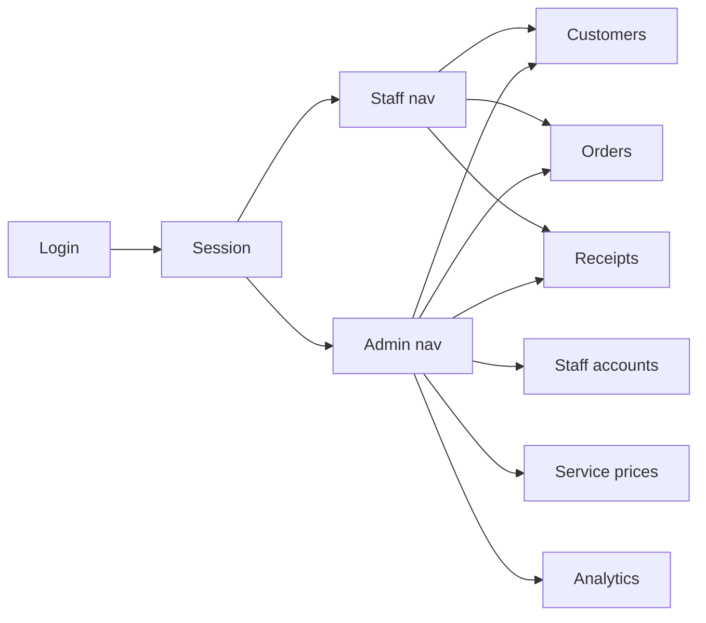

# Laundry Management Frontend

Greenfield project in an empty workspace. One static app: no Bootstrap, Tailwind, Chart.js, CDNs, or other libraries. Persistence is `localStorage` (a stand-in database) so login, orders, and receipts work without a server.

## Access model

Single login screen. Two seeded accounts (shown on the login card so the UI can be tried immediately):

- Administrator: `admin` / `admin123` — staff accounts, service prices, analytics, delete records
- Staff: `staff` / `staff123` — customers, drop-offs, order status, view and print receipts

Role checks live in the data layer, not only in hidden buttons. A staff session cannot call delete, price edit, or staff-admin functions.

Staff home is an operations board: today’s drop-offs, items in washing, ready for pickup. Admin home adds revenue and a link into analytics. Analytics itself is admin-only.

## What each screen does

- **Customers.** Search by name or phone. Create and update a profile (name, phone, email, notes). Returning customers are picked from the list when starting an order. Visit history is the list of that customer’s orders. Only an admin can delete a profile.
- **New order.** Pick a customer, add lines for Wash & Fold, Dry Cleaning, Ironing, and Duvet Cleaning with quantity. Rate comes from the current price list and is stored on the line so later price changes do not rewrite old receipts. Status starts at Drop-off.
- **Order progress.** Filter by status. Move a batch along Drop-off → Washing → Ready for pickup → Completed. Each transition records who changed it and when.
- **Receipts.** Saving an order creates a numbered receipt (`LM-1001`, incrementing). Detail view is itemized: services, qty, rate, line total, grand total, customer, status, date. Lookup by receipt number, customer, or phone. Print uses `window.print()` and a print stylesheet that shows only the receipt. Delete is admin-only and also removes the linked order so records stay consistent.
- **Staff accounts (admin).** List, add, and disable staff. Cannot remove the last administrator.
- **Service prices (admin).** Edit the four service rates. New orders use the updated rate; existing receipts keep the rate they were issued with.
- **Analytics (admin).** Built with inline SVG, no chart library.
  - Most requested services: horizontal bars by total quantity.
  - Cost and revenue: grouped bars of revenue per service (quantity × stored rate). A small summary shows order count, completed count, and total revenue. Empty data shows a plain empty state, not a broken chart.

## File layout

- [index.html](index.html) — login plus app shell (sidebar, top bar, main outlet)
- [css/tokens.css](css/tokens.css) — colors, type, spacing (system font stack only)
- [css/layout.css](css/layout.css) — shell, sidebar, responsive stack under 800px
- [css/components.css](css/components.css) — buttons, forms, tables, badges, modal, toast
- [css/print.css](css/print.css) — receipt-only print layout
- [js/store.js](js/store.js) — seed data, `localStorage` read/write, all create/update/delete rules
- [js/auth.js](js/auth.js) — login, logout, session, `requireRole`
- [js/router.js](js/router.js) — hash routes and nav visibility by role
- [js/charts.js](js/charts.js) — SVG bar charts from plain numbers
- [js/views.js](js/views.js) — render and wire each screen
- [js/app.js](js/app.js) — boot, events, toasts

Scripts load as classic `<script>` tags in that order so the app runs from a static folder with no bundler.

Visual direction: warm off-white page, deep teal sidebar, ink text, status chips (slate drop-off, blue washing, amber ready, green completed). Receipt paper is a narrow white sheet with a ruled item table. No purple-gradient template look.

## Data shape (local store)

- `users`: id, username, password, name, role (`admin` | `staff`), active
- `services`: id, name, rate
- `customers`: id, name, phone, email, notes, createdAt
- `orders`: id, receiptNo, customerId, status, lines[{serviceId, name, qty, rate}], total, createdAt, updatedAt, history[{status, at, by}]
- `session`: user id only

Passwords sit in `localStorage` in plain text. That matches a classroom-style frontend demo and is not real authentication.

## Pitfalls

- **Not a real database or secure login.** Anyone with the browser can read `localStorage`. Fix in a later backend: hash passwords and check the role on the server. This UI keeps role checks in `store.js` so the screens stay honest for the demo.
- **Price edits rewriting history.** Rates are copied onto each order line at creation time.
- **Deleting a receipt leaving an orphan order.** Delete removes the order and its receipt together. Customer profiles stay.
- **Last admin lockout.** The store refuses to delete or demote the only active admin.
- **Empty charts.** If there are no orders, the report shows an empty message and zero totals instead of dividing by zero.
- **Print catching the whole app.** Print CSS hides the shell and prints only the receipt node.
- **Duplicate customers.** Phone is the match key; creating a customer with an existing phone updates nothing and shows an error so staff open the existing profile.
- **Lost demo data.** A “Reset demo data” control on the login screen restores the seed, because `localStorage` survives reloads and bad edits.
